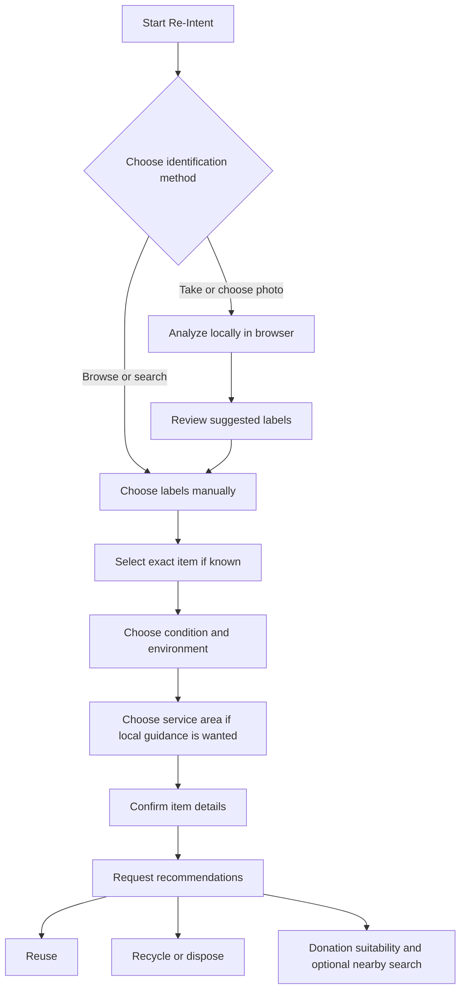
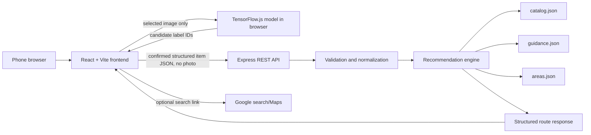

# Re-Intent — Product and System Design

- **Document status:** Planning baseline with backend, manual frontend flow, concurrent browser-side MobileNet/YOLO11 suggestions, and local Finch container packaging implemented; photo evaluation is ongoing
- **Prepared:** 8 October 2026
- **Scope:** Product workflow, frontend and backend design, data flow, recommendation logic, photo analysis, hackathon constraints, and MVP workplan.

This document consolidates the decisions and proposals discussed so far. It distinguishes the current plan from items that still need validation. It is a design document, not a claim that the system has already been implemented or that image recognition has been proven accurate.

## 1. Product purpose

Re-Intent is a phone-first website that helps a person decide what to do with an unwanted item. The user may take or choose a photo, browse or search item labels, review suggested labels, add condition and context, and receive three possible routes:

1. **Reuse** — practical ideas for using the item again.
2. **Recycle or dispose** — preparation and disposal guidance, using the supported service area where applicable.
3. **Donation** — general advice on whether donation may be worth considering, plus a search link for nearby organizations when the user chooses to pursue it.

The site is guidance, not a guarantee that a facility or organization will accept an item. The user remains in control of the chosen item, its reported condition, and whether to pursue donation.

## 2. Constraints and decisions

### Hackathon and hosting constraints

- The supplied hackathon guidance says a project can qualify for prizes by either using at least one AWS open-source tool or deploying on AWS.
- The team does not have AWS credits and has chosen the **AWS open-source-tool route**, not AWS cloud deployment.
- **Finch** is the planned AWS open-source tool: use it to build and run the project container locally. Finch is listed among the open-source choices in the supplied hackathon screenshot. Confirm the organizer accepts the planned use of Finch for eligibility before submission.
- **Do not deploy AWS Lambda, API Gateway, S3, DynamoDB, or other AWS-hosted services.** Earlier Lambda/SAM discussion was a local-development option and is not the selected production architecture.
- **Render** is the proposed external host for the container and public demo URL. Its free service terms and behavior may have limits; check them at deployment time. Hosting on Render is separate from the AWS open-source-tool eligibility path.

### Current architecture choices

- Frontend: React + Vite.
- API: Node.js + Express.
- Data for the MVP: curated, version-controlled JSON files in the project repository.
- Photo analysis: MobileNet V2 and YOLO11 nano run concurrently in the browser after photo selection. The UI shows each model's progress and optional label suggestions, without raw guesses or scores. Both require user confirmation. See `docs/Photo-Model-Evaluation.md` for the current small-sample comparison.
- Photo privacy: do not send or persist the image on the backend in the planned MVP.
- Hosting shape: serve the built frontend and Express API from one application/container where practical; build and run locally with Finch, then host the container on Render.
- No user accounts, user history, photo storage, admin interface, or database are planned for the MVP.

## 3. User experience and workflow

The primary device is a phone. Make camera, upload, and touch interactions easy to use, while preserving a complete manual-selection path.

### Main flow



### Identification and labels

- The user can take a photo, choose a photo, or skip the photo and browse/search.
- Design the first flow for one primary item per photo. If the photo contains multiple items or is unclear, ask the user to select the intended item, retake the photo, or continue manually.
- Either browser model may suggest broad labels. The user can accept, remove, replace, or add labels before recommendations are requested.
- A broad-to-exact choice should be possible, e.g. `plastic → container → oil container`. The user can stop at a broad category when they do not know the exact item.
- Labels describe different facets and can coexist; do not put every term into one flat, mutually exclusive taxonomy:
  - **Materials:** plastic, paper, cardboard, glass, metal of unknown type, iron/steel, aluminium, copper, brass, fabric/textile, wood, rubber, ceramic, and leather. These are distinct choices; selecting a specific metal replaces the broad metal label in the UI and backend.
  - **Waste types:** electronics, organic waste, and mixed waste are broad streams, displayed separately from raw materials.
  - **Specific item:** browse the expanded catalogue under collapsible headings for packaging, plastic items, electronics, food and garden, paper and cardboard, glass, metals, clothing and textiles, furniture, toys, vehicles, construction and repair, office and school supplies, kitchen items, special handling, and other items. Search also matches item names and synonyms. Duplicate terms are consolidated into existing canonical labels in `backend/data/catalog.json`.
  - **Condition:** usable, working, repairable, damaged, contaminated, unknown.
  - **Properties:** biodegradable, non-biodegradable, labeled compostable, potentially hazardous, or containing oil or chemical residue, where applicable. Biodegradable and compostable are distinct; non-biodegradable cannot be combined with either.
  - **Context:** home, workplace, outdoors.
- The photo cannot reliably establish whether an appliance works, what a container held, or whether an item is contaminated. Ask the user when these details affect advice.
- Every selectable label has general reuse and/or recycling guidance in the JSON catalogue. Item records also have a category and donation suitability; the data loader rejects incomplete entries. Specialist waste such as batteries, lamps, medicines, and chemicals needs reviewed guidance before it is offered as a specific item.
- New labels receive broad, category-level guidance as an MVP starting point. They do not imply that a specific local collector or NGO accepts an item. Review and refine special-handling advice and local rules before treating it as authoritative. Add, remove, or reclassify labels in `backend/data/catalog.json` and update `backend/data/guidance.json` where needed.
- A model-suggested item opens its item category even if the user previously closed it. The user can then open or close any category. Search also opens matching item categories. Selecting a model suggestion clears a filter that would hide the selected label.

### Results and route behavior

Show three route cards consistently, but allow a route to say it needs more information or has no suitable/verified advice. Do not invent content just to fill a card.

- **Reuse:** Show practical ideas where the catalogue contains them. Advice should match the item and, when useful, its context.
- **Recycle or dispose:** Prefer item-specific guidance for the selected area. If only a broad label is known and specificity changes the advice, ask a follow-up question or make the uncertainty clear.
- **Donation:** Treat this as a suitability suggestion, not an eligibility or acceptance check. Use the user’s reported condition as an assumption. For example, if the user marks a TV as working, the result can say, “Based on your selection, donation may be worth considering.” Do not claim that any organization will accept it.
- The user decides whether to pursue donation. If they choose to, provide a Google search or Maps search link based on the item and the area they selected. Clearly frame results as places to contact, not verified accepting organizations.
- Generic single-use items such as plastic bottles or oil containers will generally receive “probably not suitable for donation” guidance; the user can still decide to search if desired.

### Proposed website views

1. **Start:** brief purpose and actions to take a photo, choose a photo, or browse/search.
2. **Identify/review:** image preview, suggested labels, manual editing, and item search.
3. **Details:** condition, environment, and service area when relevant.
4. **Results:** reuse, recycle/dispose, donation advice and optional nearby search.
5. **About/guidance:** explain that image labels are suggestions, local instructions may vary, and organization acceptance must be confirmed by the user.

Website page navigation is separate from the API endpoints described later.

## 4. System architecture



### Component responsibilities

- **React frontend:** Camera/file input, local image inference, catalogue browsing, label correction, user questions, API requests, and result rendering.
- **Image-analysis adapters:** MobileNet and YOLO11 load on photo selection and run concurrently. Each maps a narrow set of supported outputs to optional catalogue labels. The UI shows progress and suggestions from each model separately. The adapters can be replaced as models improve.
- **Express API:** Accepts confirmed structured data, validates it, calls recommendation logic, and returns normalized results. It does not receive photos in the MVP.
- **Recommendation engine:** A plain application module, separate from Express request handlers. It resolves IDs, applies rules, and constructs route statuses and advice.
- **JSON data:** Starter item labels and general advice, plus source-backed national guidance for selected items in India.
- **Container/hosting:** Finch is used locally for the container workflow. Render is the proposed external host for a public demo.

## 5. Photo analysis and processing

### Proposed MVP approach

The first prototype uses **TensorFlow.js MobileNet V2** to classify the single primary object in the browser. The model loads when a user selects a photo. Model weights come from TensorFlow's public Google Storage model archive, while image data stays in the browser and is not sent to the API. A narrow mapping turns selected ImageNet classes into editable catalogue suggestions: television to Television, bottle to the broad Container label, garment classes to Clothing, and selected devices to Electronics. A class explicitly naming plastic, paper, or cardboard may suggest that material. The model does not identify oil contamination, working condition, or most waste-specific categories. No accuracy claim is made until it is evaluated on realistic phone photos. See [MobileNet documentation](https://github.com/tensorflow/tfjs-models/blob/master/mobilenet/README.md).

The implementation maps the leading supported MobileNet class, plus specific items from lower-ranked top-five predictions, when their raw score is at least 10%. Lower-ranked or low-scoring matches are treated cautiously, and broad materials or Electronics are not suggested from lower-ranked guesses. This allows a recognizable object such as a computer mouse to be offered when the model ranks it below unsupported guesses. **YOLO11 nano** concurrently runs the official COCO object detector in the same browser on the same photo. Its ONNX weights and ONNX Runtime Web assets are served by the application, so photo pixels stay local. YOLO11 can suggest broad objects such as a bottle, but COCO object classes do not specify the bottle's material or contents. YOLO11 detections below a 50% raw score do not become catalogue suggestions. The UI shows each model's running or finished state and any suggested labels. It does not show raw guesses, scores, or timing, and no model result is applied automatically. See [YOLO11 documentation](https://docs.ultralytics.com/models/yolo11/).

The TrashNet dataset is a possible starting point for broad waste classes: glass, paper, cardboard, plastic, metal, and trash. Its repository describes 2,527 images, mostly photographed against a white background, so its training conditions may not match varied phone photos. It does not cover every Re-Intent item type, including all electronics, clothing, or organic waste. Treat it as a prototype/training resource, not evidence of field accuracy. See [TrashNet dataset](https://github.com/garythung/trashnet).

### Prediction handling

1. The user chooses an image in the browser.
2. The frontend preprocesses it for MobileNet and YOLO11, then starts both inferences concurrently in the browser.
3. Each model returns its own object guesses and raw scores.
4. The frontend maps supported classes from each model to Re-Intent catalogue IDs.
5. The UI shows both sets of optional label suggestions separately; it never selects a label automatically.
6. Once both finish, if neither has a supported label suggestion, the UI gives a friendly link to the manual label picker. Model failures also leave manual selection available.
7. The user confirms the item and enters condition/context.
8. The frontend sends only confirmed structured fields to the API.

Raw model scores remain internal to the suggestion rules and evaluation report; the user-facing page shows only status and selectable labels. Do not infer appliance function, contamination, donation eligibility, or local recycling acceptance from a photo. Each model only predicts classes it was trained/configured to recognize; manual selection covers other classes.

### Photo storage and database implications

- Accepting a photo in the browser does **not** require a database.
- In the chosen flow, the photo is processed in the browser and is not submitted to the backend or stored by Re-Intent.
- A backend photo-upload endpoint, image history, and photo storage are not part of the MVP.
- A database is a separate question from image analysis. It would become useful for large/frequently edited catalogues, organization-managed data, user history, or an admin workflow, none of which is currently planned.

## 6. Data model and JSON files

### What “version-controlled JSON” means

JSON is a plain-text format for structured records. Store the MVP catalogue/guidance JSON files in the project directory and track them in Git alongside the code. The repository may be local and/or synchronized to a remote service such as GitHub; “repository” means the Git-tracked project, not necessarily GitHub specifically.

Git records edits, lets the team compare/revert guidance changes, and makes the data reviewable. Since the running API loads this data from the application files, editing the guidance requires committing the change and redeploying/restarting the application for the live service to use it. This is simple and low-overhead for a small hackathon catalogue, but it means content changes go through a software release. That is the MVP tradeoff.

### Proposed files

```text
backend/
  data/
    catalog.json       # labels, hierarchy, facets, synonyms
    guidance.json      # reuse, recycle/dispose, donation suitability rules/advice
    recycle-rules.json # ordered condition and material rules for disposal
    areas.json         # service areas supported in the MVP
```

No `organizations.json` is planned because we are not maintaining or verifying an organization directory. The optional Google search link is generated from the user’s item and selected area.

### Example catalogue record

```json
{
  "id": "oil-container",
  "label": "Oil container",
  "group": "item",
  "parentId": "container",
  "synonyms": ["oil canister", "plastic oil bottle"],
  "materialIds": ["plastic"]
}
```

### Example guidance record

```json
{
  "itemId": "television",
  "reuse": [
    {
      "title": "Consider repair or reuse",
      "text": "If it works or can be repaired safely, consider keeping or passing it on."
    }
  ],
  "recycleOrDispose": {
    "text": "Check the selected area's electronics disposal guidance.",
    "areaSpecific": true
  },
  "donation": {
    "suitability": "consider_if_usable",
    "text": "If you report that it works and is in usable condition, donation may be worth considering. Contact an organization to confirm acceptance."
  },
  "sourceNotes": [],
  "lastReviewed": "YYYY-MM-DD"
}
```

These are design examples. Actual item instructions and local guidance must be researched and reviewed before being presented as authoritative.

### Suggested confirmed item request shape

```json
{
  "itemId": "television",
  "materialIds": ["electronics"],
  "propertyIds": [],
  "condition": "working",
  "environment": "home",
  "areaId": "in",
  "area": "Pune"
}
```

`itemId` can be absent if the user only selected a broad category. IDs should be from the catalogue; do not rely on free-form labels for recommendation logic. User selections are treated as reports, not independently verified facts.

## 7. API endpoints

All API paths are versioned under `/api/v1`. The app can serve the frontend and API from one host, so requests can be same-origin.

### `GET /api/v1/catalog`

Returns labels available for browse, search, and correction. Optional query parameters may include `q` for text search and `group` for a facet such as `material` or `item`.

### `GET /api/v1/areas`

Returns supported areas and their scope. The first supported area is `in` (India), with national guidance. An optional free-text `area`, such as a city, makes the donation search more specific; it does not turn national guidance into verified city instructions. Precise GPS access is not required.

### `POST /api/v1/recommendations`

Accepts the **confirmed item details** and returns the three route objects. It does not accept a photo.

Example response shape:

```json
{
  "item": {
    "itemId": "television",
    "label": "Television",
    "materialIds": ["electronics"],
    "condition": "working",
    "areaId": "in",
    "area": "Pune"
  },
  "routes": {
    "reuse": {
      "status": "available",
      "title": "Reuse",
      "items": []
    },
    "recycle": {
      "status": "available",
      "title": "Recycle or dispose",
      "scope": "national",
      "localStatus": "national_guidance",
      "municipalDetailsVerified": false,
      "items": [{ "title": "Use an e-waste collection route", "text": "...", "sources": [{ "title": "E-Waste (Management) Rules, 2022 — Schedule I", "url": "https://moef.gov.in/uploads/2022/11/E-Waste-Management-Rules-2022.pdf", "reviewedAt": "2026-10-08" }] }]
    },
    "donation": {
      "status": "consider",
      "title": "Donation",
      "message": "Based on your selection that the TV works, donation may be worth considering. Confirm acceptance directly with an organization.",
      "acceptanceVerified": false
    }
  }
}
```

Donation status does not imply a verified organization match. A donation search link is returned only when `searchForDonation` is true. For recycling, `scope: "national"` means the source supports India-wide guidance; `municipalDetailsVerified: false` means the user must still confirm local collection and acceptance. If no source-backed area guidance matches the item, the API returns general advice with `localStatus: "unavailable"`.

When requested, the backend returns a Google Maps search URL. The action should be labeled **Search nearby organizations**, not “Find a verified accepting NGO.” Search results may be inaccurate or stale; the user needs to confirm details directly.

### `GET /health`

Returns a minimal status for local checks and hosting health probes, e.g. `{"status":"ok"}`.

### Not planned for the MVP

- Photo upload/storage endpoint
- User registration/authentication
- User history/favorites
- Admin/content editing endpoints
- Organization acceptance/booking endpoint

These are intentionally excluded from the initial workflow, not forgotten requirements.

## 8. Recommendation processing and data routing

The recommendation service should be separate from Express route code and work approximately as follows:

1. **Validate:** Check required fields and allowed IDs/enums (`condition`, `environment`, `areaId`), and constrain the optional free-text `area`. Enforce request size limits.
2. **Normalize:** The UI selects canonical catalogue IDs; the backend deduplicates labels. Catalogue search supports synonyms.
3. **Resolve specificity:** Prefer an exact item. If only a broad material is supplied, use broad guidance only where appropriate; otherwise ask a follow-up question.
4. **Load applicable guidance:** Retrieve the item-level and, where safe, parent-category advice from JSON.
5. **Build reuse route:** Select matching reuse advice and context notes.
6. **Build recycle/dispose route:** Check hazardous properties and oil or chemical residue labels first. Then match the first applicable rule in `recycle-rules.json` against the item, material, condition, and, for paper cups that are not contaminated, lining. `Contaminated` directly means dirty or unusable and selects disposal advice without a second residue question. If the material or paper cup lining is needed but unknown, return `need_more_information` with the next question. Use source-backed area guidance when no more specific safety or condition rule applies. Do not infer a city collection stream from free-text `area`.
7. **Build donation advice:** Use item-category suitability and the user-reported condition. Do not query or claim verified organization acceptance. Respect the user’s choice to open a search.
8. **Return a consistent response:** Each route has a status, explanatory text, and optional actions/items. Missing knowledge is represented explicitly.

The backend is stateless for the MVP: it processes a request and returns a response without storing user records.

## 9. Backend code organization (proposal)

```text
backend/
  src/
    app.js                    # Express routes, Helmet, and error handling
    server.js                 # API startup
    data-store.js             # JSON loading and integrity checks
    recommendations.js        # validation and recommendation rules
  data/
    catalog.json
    guidance.json             # general and India-wide source-backed entries
    recycle-rules.json        # condition-based recycle/dispose steps
    areas.json
  test/
    backend.test.js
```

The Express app now serves the built frontend from `frontend/dist` when it is available. During development, Vite serves the frontend and proxies API requests to Express. Recommendation rules remain separate from HTTP route handling. The root Dockerfile builds the frontend and packages it with the backend for local Finch runs and future hosting.

## 10. Error handling, privacy, and safety

- Return clear client errors for malformed JSON, unsupported label IDs, and missing fields; return a generic server error for unexpected failures without exposing stack traces.
- Validate all user-supplied IDs against the catalogue and areas list.
- Avoid logging photos or unnecessary user details. The backend should never receive the photo in the planned MVP.
- Avoid collecting precise location by default. An area selection is enough for the planned local search/guidance.
- Keep prediction language tentative and allow manual correction.
- Donation wording must distinguish “may be worth donating” from “an organization will accept this.”
- Recycling/disposal information can vary locally; show the supported area and source/review metadata where available.

## 11. What the JSON approach trades off

**Benefits:** no database setup or operating cost, simple local development, easy to inspect/review in Git, adequate for a small catalogue.

**Costs:** content edits require a code/data commit and redeployment; non-developers cannot update guidance through an admin screen; simultaneous edits can conflict; broad geographic coverage and rapidly changing content become harder to maintain.

Move to a database/admin workflow only if the catalogue becomes large, changes often, needs non-developer editors, or requires persisted user-owned data. Photo analysis alone is not a reason to add a database.

## 12. Local development, hackathon tool, and publishing

1. Develop the React/Express application and its container recipe.
2. Use Finch to build and run that container locally; this is the planned AWS open-source-tool use.
3. Test the experience on phones and desktop browsers, including manual selection and uncertain image predictions.
4. Connect the repository/container build to Render to obtain a public demo URL.
5. Keep AWS cloud deployment commands out of the workflow unless the team later explicitly changes the no-credits constraint.

Render’s free tier may have sleep, capacity, or usage limitations; check provider terms before the demo and test the live URL in advance. The public URL is provided by Render, not Finch. Finch is a development/container tool, not a hosting provider.

## 13. Workplan and validation methodology

### Phase 1 — Lock the content scope

- Begin with India-wide national guidance; a municipality can be added later for collection details.
- Choose a modest initial item catalogue, including broad labels and exact items.
- Gather/review reuse and disposal guidance and record sources/review dates.
- Define donation-suitability wording and search query format without claiming organization acceptance.

### Phase 2 — Build the end-to-end manual flow

- Implement browse/search labels, condition/environment/area selection, and results.
- Implement JSON-backed catalogue and recommendation rules.
- Confirm all three routes handle “available,” “need more information,” and “no suitable guidance” cases.

### Phase 3 — Evaluate and improve photo suggestions

- The browser model is integrated behind the image-analysis adapter; review its output and mapping before broadening coverage.
- Test a small varied photo set (lighting, angle, background, item types) early.
- Review failure patterns; tune the model or keep manual selection as the fallback.
- Treat broad material labels as the initial prediction target; let the user choose the exact item.

### Phase 4 — Package and demo

- Run the container locally with Finch.
- Test mobile camera/file selection, label correction, recommendation response, and Google search handoff.
- Deploy on Render and verify the public URL and free-tier behavior before presenting.

## 14. Open decisions and assumptions

These remain to be decided or validated; they are not hidden implementation facts:

1. Which municipality should be added after the initial India-wide guidance?
2. Which further specialist items should be added after the current expanded catalogue and source review?
3. Which municipal sources will support collection and drop-off guidance?
4. Does the hackathon organizer accept Finch as the AWS open-source tool for eligibility? The supplied screenshot lists it, but confirm the event’s interpretation.
5. Does the proposed model perform adequately on realistic phone photos and target phones? This must be tested; no accuracy guarantee is made.
6. Will location be typed/selected as an area, or will an optional location-permission flow be added later?

## 15. External technical references

- [TensorFlow.js image classification and transfer learning](https://www.tensorflow.org/js/tutorials/transfer/image_classification)
- [TrashNet dataset, classes, and collection notes](https://github.com/garythung/trashnet)
- [AWS Finch on Windows](https://aws.amazon.com/blogs/opensource/finch-container-development-tool-now-for-windows/)
- [Render free services and limitations](https://render.com/docs/free)
- [India Solid Waste Management Rules, 2026](https://moef.gov.in/uploads/pdf-uploads/pdf_69a16e3b04c107.91022257.pdf)
- [India E-Waste (Management) Rules, 2022](https://moef.gov.in/uploads/2022/11/E-Waste-Management-Rules-2022.pdf)
- [US EPA standardized recycling material categories](https://www.epa.gov/circulareconomy/standardized-terms-materials-accepted-municipal-recycling-programs) — vocabulary reference only, not India-specific collection rules.
- [US EPA biodegradable and compostable distinction](https://www.epa.gov/trash-free-waters/frequently-asked-questions-about-plastic-recycling-and-composting) — definition reference; local composting acceptance still needs confirmation.

